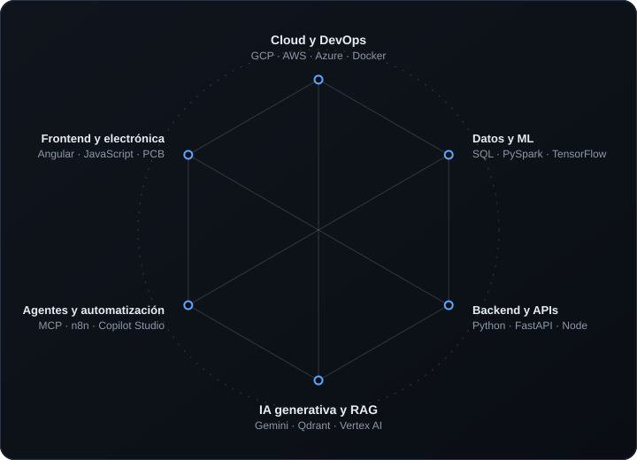

  
   
  
   
  
  

## Sobre mí

Soy ingeniero electrónico egresado de la **Universidad Nacional de Ingeniería (UNI)**, del quinto superior de mi promoción, y desarrollador enfocado en **IA generativa**.

Me interesa diseñar sistemas que combinan modelos de lenguaje, bases vectoriales y agentes para automatizar procesos y apoyar decisiones con datos. Vengo de la electrónica, así que disfruto entender un sistema de punta a punta: desde el diseño de una PCB hasta una API desplegada en la nube.

- **Ubicación:** Lima, Perú
- **Formación:** Ingeniería Electrónica, UNI
- **Idiomas:** español e inglés

## Habilidades

  
   
  Hexágono inspirado en el gráfico de Nen. Los niveles son una referencia, no una medición.

 

| Área | Herramientas y conceptos |
| :-- | :-- |
| **GenAI y RAG** | Gemini, Vertex AI, embeddings, chunking, bases vectoriales (Qdrant, Pinecone, Supabase), Hugging Face |
| **Agentes y automatización** | Model Context Protocol (MCP), n8n, Copilot Studio, Dialogflow, watsonx Assistant, Power Automate, Power Apps |
| **Backend y APIs** | Python, FastAPI, TypeScript, Node.js, webhooks, streaming SSE, pytest |
| **Datos y ML** | SQL y PL/SQL, PySpark, pandas, NumPy, matplotlib, Power BI, TensorFlow, deep learning, NLP |
| **Cloud y DevOps** | GCP (Cloud Run, Firestore, Cloud Tasks), AWS (Glue, S3), Azure DevOps, Docker, Terraform, Git |
| **Frontend y electrónica** | Angular, HTML, CSS y JavaScript, diseño y fabricación de PCB |

  

## Proyectos

### Loma · Chatbot RAG para una ONG de ecoturismo

Asistente conversacional que atiende consultas por **WhatsApp** y desde un **widget web** embebible, respondiendo con información de los propios documentos de la organización.

- **Pipeline RAG:** ingesta de PDFs, URLs y texto, división en fragmentos de 500 palabras con solape, embeddings con Gemini y búsqueda en Qdrant.
- **Umbral de similitud:** si no hay contexto suficiente, no inventa una respuesta y deriva la conversación a una persona.
- **WhatsApp asíncrono:** el webhook responde al instante y el procesamiento pasa por Cloud Tasks, para respetar el límite de tiempo de Meta.
- **Leads y CRM:** sesiones en Firestore, puntaje de intención y sincronización de contactos con HubSpot.
- **Widget propio:** JavaScript puro, sin dependencias, con respuestas en streaming (SSE) y pantalla completa en móvil.
- **Calidad y despliegue:** panel de administración, tests con pytest sin llamadas reales a APIs y despliegue en Cloud Run con Docker.

### Otros proyectos

<table>
  <tr>
    <td width="50%" valign="top">
      <b>RAG para documentos legales</b> 
      Pipeline completo: web scraping, estrategias de chunking y embeddings con Vertex AI, ajustado para maximizar la precisión de las respuestas. 
      Vertex AI · Python · scraping
    </td>
    <td width="50%" valign="top">
      <b>AEO Tracker</b> 
      Aplicación full-stack que mide y audita la presencia e impacto de marcas en distintos motores de IA generativa. 
      FastAPI · Angular · GCP
    </td>
  </tr>
  <tr>
    <td valign="top">
      <b>Agentes en Copilot Studio</b> 
      Chatbots corporativos con herramientas (tools) personalizadas e IA generativa integrada. 
      Copilot Studio · Power Platform
    </td>
    <td valign="top">
      <b>ETL en AWS</b> 
      Servicios AWS Glue y S3 desplegados con Docker y Terraform para ejecutar procesos ETL de datos en local. 
      AWS Glue · S3 · Docker · Terraform
    </td>
  </tr>
  <tr>
    <td valign="top">
      <b>Servidor MCP</b> 
      Práctica con el SDK de Model Context Protocol: servidor en TypeScript con herramientas tipadas con Zod, como una consulta de clima vía Open-Meteo. 
      TypeScript · MCP SDK · Zod
    </td>
    <td valign="top">
      <b>Visualización de datos</b> 
      Scripts que comparan indicadores entre periodos y generan gráficos listos para reportes. 
      Python · matplotlib · NumPy
    </td>
  </tr>
</table>

## Licencias y certificaciones

| Área | Certificación | Emisor | Año |
| :-- | :-- | :-- | :-: |
| **IA y ML** | Macroentrenamiento de Inteligencia Artificial (Python, ML, DL, NLP) | UNAM | 2025 |
| | Fundamentals of Deep Learning | NVIDIA | 2025 |
| | Machine Learning Engineer (Git, Docker, MLOps, GCP) | IEEE CIS UNI | 2024 |
| | n8n: agentes de IA, RAG y bases vectoriales | Udemy | 2025 |
| **Automatización** | Microsoft Copilot Studio | Udemy | 2025 |
| | Microsoft Copilot 365 | Udemy | 2025 |
| | Microsoft Power Apps | Udemy | 2025 |
| | Microsoft Power Automate | Udemy | 2025 |
| **Cloud y DevOps** | GCP Digital Leader | Udemy | 2025 |
| | AWS Cloud Practitioner Essentials | AWS | 2025 |
| | Azure DevOps | Udemy | 2025 |
| | Curso profesional de Git | Código Facilito | 2024 |
| **Datos y programación** | Curso profesional de Python | Código Facilito | 2024 |
| | Análisis de datos con Python (NumPy y pandas) | Código Facilito | 2024 |
| | SQL (Intermediate) | HackerRank | 2025 |
| | Excel y Power BI | Cámara de Comercio Exterior | 2024 |
| **Electrónica e idiomas** | Diseño y fabricación de PCB | CTIC UNI | 2023 |
| | Examen de suficiencia de inglés | UNI | 2022 |

## Contacto

  

